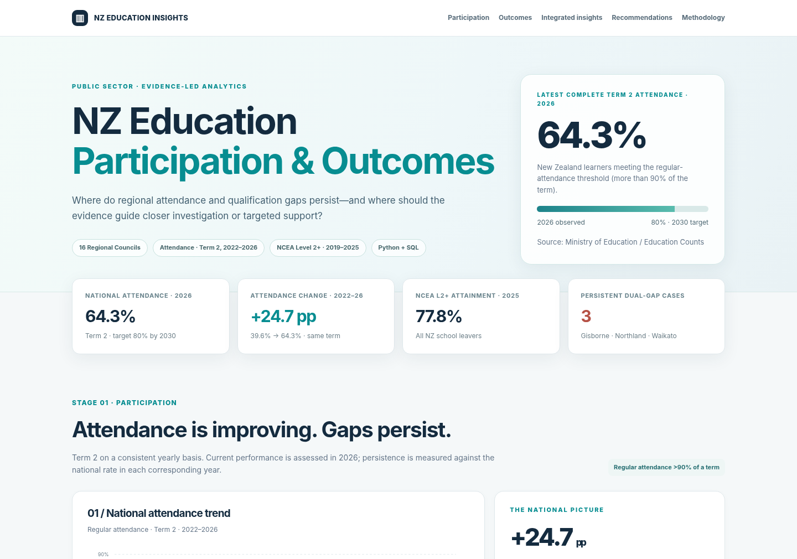

# NZ Education Participation & Outcomes Insights

**An independent, evidence-led public-sector analytics portfolio**  
**Python · SQL · data quality · regional insights · interactive dashboard**

> **Question:** Where are gaps in school attendance and educational outcomes persisting across New Zealand regions and learner groups—and which areas warrant closer investigation or targeted support?

**Interactive Dashboard:** [Launch dashboard](https://baobao0517.github.io/nz-education-participation-outcomes/)  
**Dashboard source:** [`docs/index.html`](docs/index.html)

*Publication note: the Pages link becomes active when this repository is created and GitHub Pages is enabled on `main` / `docs`. The supplied project archive is fully built and viewable offline prior to publication.*

## Executive overview

Using official **New Zealand Ministry of Education / Education Counts** datasets, this project compares:

- **Regular attendance:** proportion of students attending **more than 90% of Term 2**, **2022–2026** across all **16 Regional Councils**.
- **Primary outcome:** proportion of **school leavers** attaining **NCEA Level 2 or above (or equivalent)**, with **2019–2025** regional trends and 2025 subgroup comparisons.
- **Integrated 2025 regional comparison:** the **2025 Term 2** attendance rate and **2025 school-leaver** NCEA L2+ rate, each expressed as a gap to its **own published national benchmark**.

### Four decision-oriented findings

| Finding | Evidence | Public-sector implication |
|---|---|---|
| **1. Attendance is improving, but regional gaps persist.** | National Term 2 regular attendance rose from **39.6% (2022)** to **64.3% (2026)** (**+24.7 pp**), still below the government's **80% 2030 target**. | Monitor current levels *and* change; assess whether improvement is reaching lagging schools and areas. |
| **2. Some regions face persistent dual gaps.** | **Gisborne, Northland, Waikato** each remained below the **same-year** national attendance rate in all 5 years (2022–26) and below the **same-year** national NCEA L2+ rate in all 7 years (2019–25). | Prioritise deeper investigation of attendance barriers, leaving pathways, school-level variation, and access to support. |
| **3. Participation and attainment do not always align.** | **Tasman** had **+3.0 pp** attendance versus NZ in 2025 but **−5.0 pp** NCEA L2+ attainment. Its L2+ rate was **82.6% in 2019** versus **72.8% in 2025**. | Review leaving-age mix, school pathways, school type and multi-year stability—not just attendance. |
| **4. Recovery deserves evaluation, not assumption.** | **Taranaki** NCEA L2+ rose from **72.9% in 2023** to **79.6% in 2025**. | Examine programme implementation and comparable cohorts before treating practices as transferable. |

The 2025 national NCEA L2+ school-leaver attainment rate was **77.8%**. School leaver attainment is **not** an exam score and **not** a measure of the same students represented in attendance statistics.

## Dashboard sections

1. **Participation:** national attendance trend; interactive 2026 16-region level × annual improvement matrix; term-matched persistence heatmap (2022–26).
2. **Outcomes:** national NCEA L2+ trend; 2025 all-region ranking; within-group comparisons for **school EQI**, **leaving age**, and **total-response ethnicity**; multi-year attainment persistence (2019–25).
3. **Integrated insights:** interactive **2025 attendance × 2025 NCEA** four-quadrant view with official national benchmark lines only.
4. **Decision support:** evidence-based investigation priorities and explicit additional evidence required before policy decisions.



## Reproduce and inspect

The GitHub repository contains **validated aggregates**, scripts, tests, and documentation; it **does not contain the large official source ZIP/XLSX files**. All original data sources remain linked in the documentation.

**Run the dashboard locally:** Open [`docs/index.html`](docs/index.html) in any modern browser. No server or external JavaScript libraries are required.

**Rebuild the standalone HTML from verified aggregate JSON:**

```bash
python src/render_site.py
```

**Run automated consistency tests and SQL checks:**

```bash
python -m unittest discover -s tests -v
python src/verify_sql.py
```

**Fully regenerate aggregate data from the official source files:**

1. Download the official **Regular attendance 2022–2026** Excel workbook and **Machine-readable school leavers 2015–2025** ZIP from Education Counts.
2. Save them in `data/raw/` under the names listed in [`data/README.md`](data/README.md).
3. Run `python src/extract_attendance.py` (requires the `artifact_tool` spreadsheet reader), followed by `python src/build_analysis.py` and `python src/render_site.py`.
4. Run the tests and SQL checks. All source reconciliation assertions are encoded in the scripts.

The validated 90-row Term 2 attendance extract and derived public aggregates are included in `data/verified/` for reproducibility without redistribution of the source binaries.

### Key source reconciliation

- 2022–2026 Term 2: **90 attendance records** = 16 councils + national `All` + `Area Outside` across 5 years. Counts reconcile each year.
- School leavers: **365,292 source CSV records**; 2025 `All Leavers` filtering and subgroup checks produce **70,786 leavers**, **55,062 attaining NCEA L2+** → **77.8%**.
- **6,045** 2025 leavers have no attributable Regional Council (`Not Applicable`). National 77.8% includes them; the 16-region pooled subtotal is 81.1%, used **only** in like-for-like regional subgroup comparisons.
- Ethnicity uses **total response**, and one student can appear in multiple ethnic categories; group denominators must never be summed as unique students.

## Methods and documentation

- [Executive summary](docs/EXECUTIVE_SUMMARY.md)
- [Methodology and KPI definitions](docs/METHODOLOGY.md)
- [Data validation and limitations](docs/DATA_VALIDATION.md)
- [Official sources and provenance](docs/SOURCES.md)
- [SQL analytics](sql/education_insights.sql)
- [Publication / project status](docs/PROJECT_STATUS.md)
- [GitHub Pages publishing instructions](docs/PUBLISHING.md)

## Interpretation and ethics

**Descriptive association ≠ causation.** Attendance and school-leaver attainment use **different populations**, even in a shared calendar year. The 16-region comparison is ecological; it cannot estimate the impact of attendance interventions, school quality or ethnic identity on attainment. Small cells (n < 30) are not displayed in interactive subgroup comparisons; EQI describes school-level socioeconomic barriers and must not be used to rank learners.

**Prepared:** November 2026. **Author:** Nicole Xiao. This is an independent portfolio project, **not an official Ministry of Education report**.
